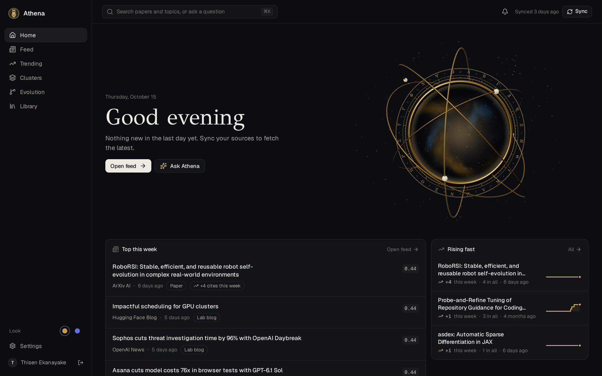
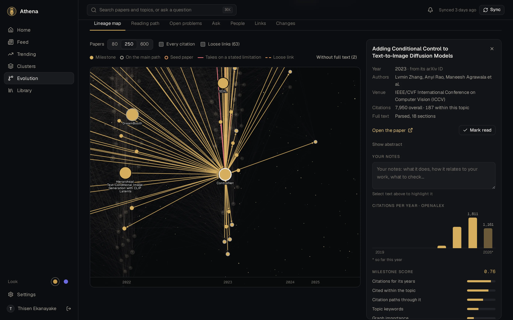
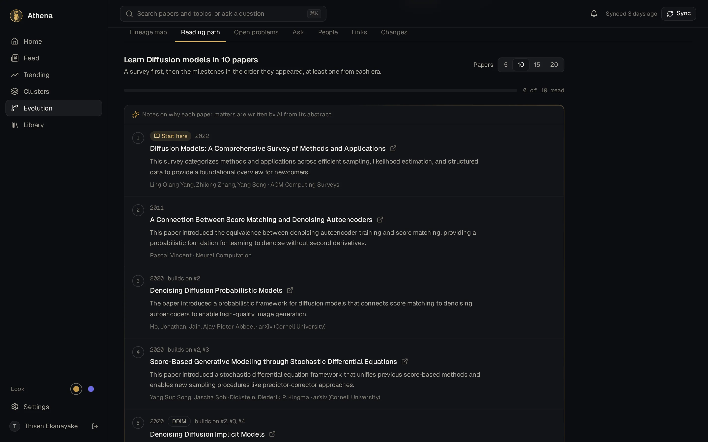
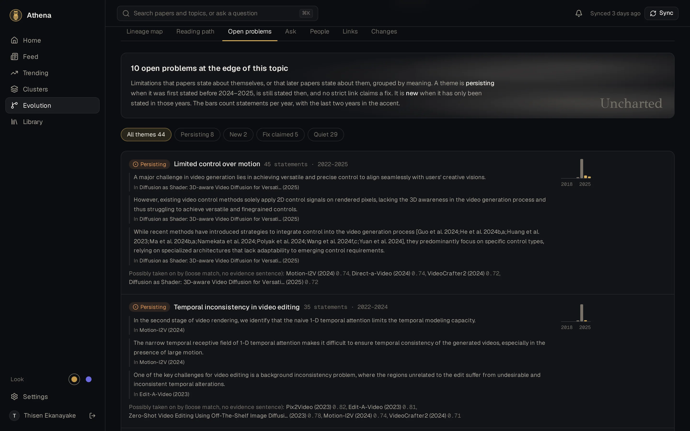
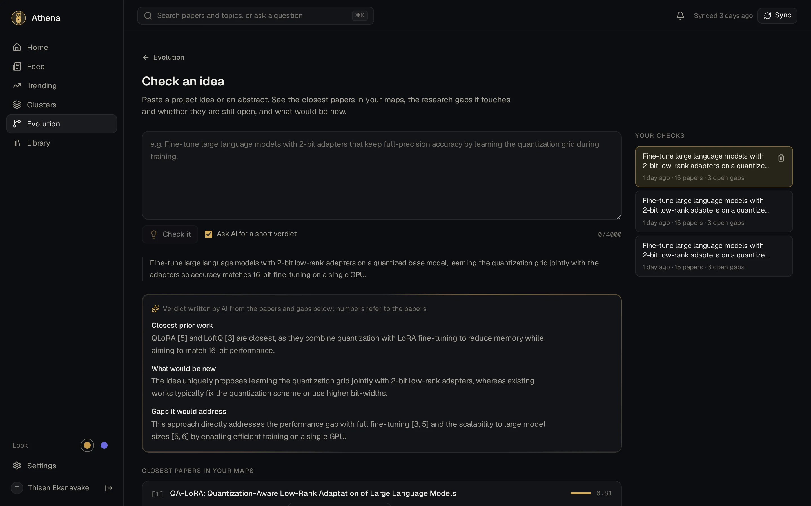
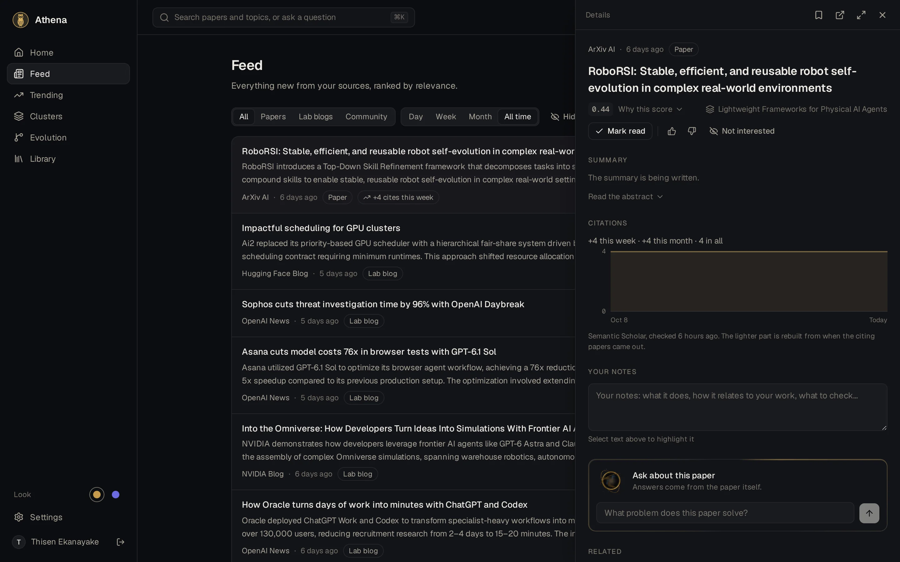
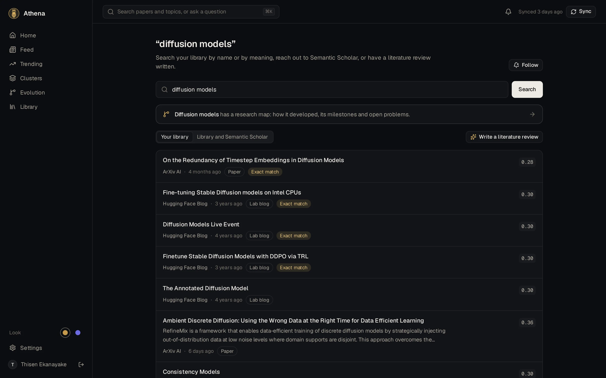
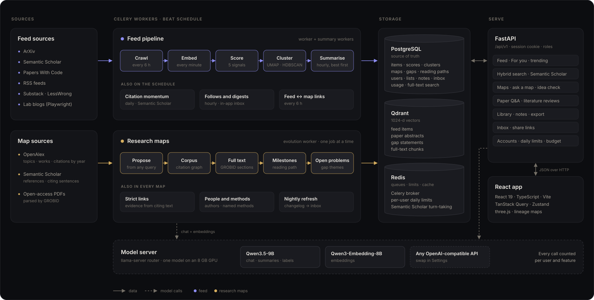

<div align="center">


# Athena

**See how a research field grew, what is new in it, and what is still unsolved.**

Athena collects AI papers and posts, ranks and summarises them, and builds research maps for any topic:
the milestones, the reading order and the open problems, all on your own GPU or any OpenAI-compatible API.

[](https://github.com/Thisen-Ekanayake/Athena/actions/workflows/ci.yml)
[](https://github.com/Thisen-Ekanayake/Athena/actions/workflows/cd.yml)
[](LICENSE)
[](https://github.com/Thisen-Ekanayake/Athena/commits/main)
[](https://www.conventionalcommits.org)




</div>

## Features

**Research maps**: type any topic and Athena builds its map from OpenAlex, Semantic Scholar and the papers' full text.

- **Lineage map**: a topic's papers on a timeline. Select one to trace what it built on and what built on it.
- **Milestones and reading path**: learn a field in 5 to 20 papers, survey first, with a note on why each one matters.
- **Open problems**: limitations papers state about themselves or each other, grouped into themes marked persisting, new, fix claimed or quiet.
- **Ask a map**: answers from the papers' full text, citing paper and section.
- **Check an idea**: paste an idea or abstract to see the closest prior work, the gaps it touches and what would be new.
- **Kept up to date**: maps refresh on a schedule, with a changelog, follows and an in-app inbox. Export to PNG, SVG, BibTeX, RIS, Markdown or CSV, or share a read-only link.

**Feed and reading**

- Ingests ArXiv, Semantic Scholar, Papers With Code, RSS, Substack, LessWrong and scraped lab blogs.
- Ranks items on citations, engagement, recency and source authority (each kind of item weighs only the signals it has data for), with a personal **For you** order learned from your reactions and saves. No one source fills more than a quarter of a page.
- Citation momentum (the **Rising** page), topic clusters, AI summaries and Q&A on any paper.
- Reading lists, read marks, notes and highlights.

**Search and writing**

- Hybrid search (Postgres full text + vectors) over your library, with live Semantic Scholar results.
- Literature reviews grounded in a map or in search results; export reviews and reading lists.

**Ready for a team**

- Accounts with admin and user roles; the admin creates accounts (no public sign-up).
- Per-user daily limits, a monthly budget and token caps, with usage tracked per feature.
- Runs fully local (Qwen3.5-9B + Qwen3-Embedding-8B on an 8 GB GPU), or point it at any OpenAI-compatible API from Settings.

## Screenshots

<table>
  <tr>
    <td width="50%"><br /><sub><b>Lineage map</b>: a paper's thread, citations per year and milestone score</sub></td>
    <td width="50%"><br /><sub><b>Reading path</b>: learn diffusion models in 10 papers</sub></td>
  </tr>
  <tr>
    <td><br /><sub><b>Open problems</b>: stated limitations grouped into themes</sub></td>
    <td><br /><sub><b>Check an idea</b>: closest prior work and what would be new</sub></td>
  </tr>
  <tr>
    <td><br /><sub><b>Feed</b>: ranked items, with summary, momentum, notes and Q&A</sub></td>
    <td><br /><sub><b>Search</b>: exact matches first, then by meaning</sub></td>
  </tr>
</table>

## Quick start

**Prerequisites:** Docker, and for the AI features [llama.cpp](https://github.com/ggml-org/llama.cpp)'s `llama-server` with the two GGUF models in `models/` (see `config/llama-router.ini`; about 7 GB of GPU memory). Any OpenAI-compatible API works instead.

```bash
cp .env.example .env

# Full stack in Docker (pre-built images from GHCR; --build to build locally, --down to stop)
./run_docker.sh

# Or native dev: infra in Docker, API / workers / frontend / model server on the host, with hot reload
pip install -r requirements.txt -r requirements-dev.txt && playwright install chromium
./run_native.sh                # --stop to stop
```

Open http://localhost:5173 and create the admin account. There is no public sign-up: the admin adds people in **Settings → Users**. The app calls the API on its own address (`/api/v1`): nginx passes it on in Docker, and Vite does in native dev. The API docs (`/docs`, `/redoc`) are off unless `DOCS_ENABLED=true`.

The database schema is created and kept up to date by Alembic when the API starts (`scripts/setup_project.py` runs the same step). A database made before Alembic is brought up to date and stamped automatically the first time.

With Docker, start the model server on the host (it needs the GPU); the containers reach it at `host.docker.internal:8080`:

```bash
llama-server --models-preset config/llama-router.ini --models-max 1 --port 8080
```

### Behind HTTPS

To serve Athena from another machine, put an HTTPS reverse proxy (Caddy, Traefik, nginx, …) in front of the frontend on port 5173. The proxy must send `X-Forwarded-Proto`, which all of these do. The release Compose file publishes the API on 127.0.0.1 only and trusts nginx's forwarded headers (`FORWARDED_ALLOW_IPS`). That way, the session cookie is marked `Secure` and rate limits see each visitor's address. If you expose the API some other way, set `FORWARDED_ALLOW_IPS` to your proxy's address.

## Configuration

Everything is set through environment variables (`.env`, read by `athena/api/config.py`). The important ones:

| Variable | Purpose |
|---|---|
| `DATABASE_URL`, `REDIS_URL`, `QDRANT_URL` | Services; default to the Compose addresses |
| `LLM_*`, `EMBED_*` | Chat and embedding endpoints (also editable in **Settings → Models and keys**) |
| `SEMANTIC_SCHOLAR_API_KEY` | Optional; higher rate limits for maps, momentum and search |
| `LIMIT_*_PER_DAY`, `MONTHLY_BUDGET_USD`, `USER_MONTHLY_TOKENS` | Per-user allowances and spending caps |
| `DOCS_ENABLED`, `DOCS_USERNAME`, `DOCS_PASSWORD` | API docs, off by default; with a password they ask for Basic Auth |
| `FORWARDED_ALLOW_IPS` | Addresses whose `X-Forwarded-*` headers the API trusts (set in the release Compose file) |

See `.env.example` for the full list.

## Architecture

Two Celery pipelines, one for the feed and one for the research maps, write to PostgreSQL and Qdrant. FastAPI serves both to the React app, and the workers and the API share one OpenAI-compatible model server.



| Path | What it holds |
|---|---|
| `athena/scrapers/` | Source collectors (ArXiv, RSS, Substack, Playwright, …) |
| `athena/pipeline/` | Celery workers: embedding, scoring, clustering, summaries, momentum |
| `athena/evolution/` | Research maps: topic search, citation graph, milestones, gaps, full text, reviews |
| `athena/api/` | FastAPI app, routers and auth |
| `frontend/` | React 19 + TypeScript + Vite (TanStack Query, Zustand, three.js) |
| `docker/` | Dockerfiles and Compose files; images publish to GHCR on push to `main` |

## Development

```bash
pip install -r requirements.txt -r requirements-dev.txt
DATABASE_URL="sqlite:///test.db" pytest tests/ -m "not network"
flake8 . --max-line-length=120 --exclude=".venv,venv,frontend/node_modules,alembic/versions"
cd frontend && npm run lint && npm test && npm run build
```

**Schema changes.** Edit the models in `athena/core/models.py`, then write a revision and apply it:

```bash
alembic revision --autogenerate -m "add papers.venue"   # review the file it writes in alembic/versions/
alembic upgrade head
alembic check                                            # the models and the database agree
```

`tests/test_migrations.py` fails when a model changes without a revision.

**Dependencies.** The `.txt` files are pinned and compiled from the `.in` files. To change a dependency, edit the `.in` file and recompile with the commands at the top of `requirements.in`. Add `--upgrade-package NAME` to move one package to a newer version.
- `requirements.txt`: the worker and local development.
- `requirements.api.txt`: the API image.
- `requirements-dev.txt`: tests and lint.

## Contributing

Branch from `main`, use [Conventional Commits](https://www.conventionalcommits.org/), and open a PR against `main`; CI must pass. See [CONTRIBUTING.md](CONTRIBUTING.md).

## License

[MIT](LICENSE) © 2025 Thisen Ekanayake
